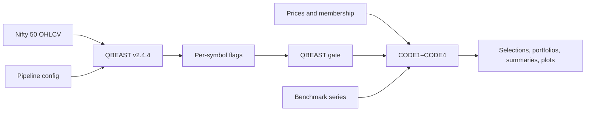

# Technical Specification

## Architecture

`run_submission_pipeline.py` runs QBEAST, checks symbol coverage, then runs all strategies. CODE1 selections are costed by `TESTER/backtester.py`; CODE2–4 include their own simulations. `TESTER/qbeast_gate.py` blocks trades when flags are blocked or missing for a date.

## Inputs

| Data | Location / key fields |
|---|---|
| Daily prices | `DATASET/Final_without_survivorship_data/`; date, OHLC, adjusted close, volume as required by each script. |
| Membership | `DATASET/Survivorship_Bias/`; effective_date and comma-separated symbols. |
| MWCB index | Nifty 50 daily OHLCV, path set in `QBEAST_pipeline_config.json`. |
| Benchmarks | Nifty 500 TRI in `TRI/`; Nifty 100/200 index histories in their price folders. |

## Outputs

- QBEAST flags and reports: `QBEAST_RUN_NIFTY500_v2.4.4/output/`.
- CODE1 result: `TESTER/output/`.
- CODE2–4 results: their respective `STRATEGY/output_*` folders.
- Each strategy writes selections, portfolio data, and a summary; some also write an equity plot. QBEAST column definitions are in the bundle spec.

Price and membership CSV schemas are summarized here; use the relevant script loader and CSV headers as the precise field reference. Missing symbol flags stop a run; missing dated flags block that symbol's trade.
